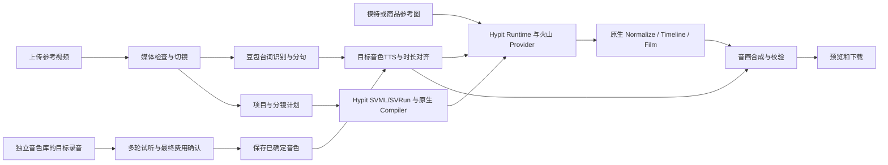

# 技术调研与复刻架构

研究日期：2026-11-15。Hypit 快照：`6bacce093695ccc2bde5aa5d7de230e9682ffa79`，包版本 `0.3.2`。以下区分源码事实、项目方案和当前已实现能力。

当前实现默认使用服务器本地素材存储和临时签名链接，并接入火山方舟 Seedance、豆包 ASR、声音复刻 V3、在线 TTS；TOS 保留为可选兼容后端。人物、商品两种完整自动任务已通过本地模拟 API 与真实 FFmpeg 的端到端验证。历史真实接口检查见 [联调记录](live-validation.md)，不代表本次进行了付费画质或槽位测试。服务器隔离部署和清理配置见 [部署说明](../deploy/README.md)，模型配置与已知限制见 [模型接入说明](models.md)。

## 1. 我们需要复刻的能力

产品目标：用户上传参考视频，上传自己的模特或商品素材，上传目标音色，系统完成画面和声音替换，再输出可下载的视频。

三类问题的技术要求不同：

| 需求 | 需要保持 | 可以改变 | 主要难点 |
| --- | --- | --- | --- |
| 按参考重拍 | 内容结构、镜头顺序、节奏与字幕风格 | 主体、场景细节、具体表演 | 分镜理解、素材生成和装配 |
| 原片人物替换 | 背景、镜头运动、动作、遮挡 | 人物身份，可选服装与体型 | 动作迁移、身份稳定、光照、手脸质量和口型 |
| 原片商品替换 | 手部交互、背景、运动、景深 | 商品外观 | 定位与跟踪、掩码、透视、包装文字、遮挡和跨帧一致性 |

后两类不能仅依靠“改提示词 + 图生视频”保证完成。需要知道选定模型具体支持参考视频、主体参考图、音频和掩码中的哪些条件。

## 2. Hypit 的实现重点

Hypit 是视频创作的语言、编译和执行系统。其示例会调用外部图像、视频和语音模型；本地部分负责媒体处理、字幕、动效与渲染。它不等于一个自带全部替换能力的视频模型。参见 [README](https://github.com/hypit-ai/hypit/blob/6bacce093695ccc2bde5aa5d7de230e9682ffa79/README.zh-CN.md)。

源码阅读重点：

| 源码位置 | 事实与价值 | 在本项目中的处理 |
| --- | --- | --- |
| `packages/compiler/src/compiler.ts` | 发现、解析源闭包，检查类型并链接图 | 采用更小的 JSON 项目描述与严格校验，首版不重写 SVML 编译器 |
| `packages/compiler/src/run.ts` | 将创作图与一次执行选择分开，支持历史输出 | 区分项目、执行计划、任务记录、已完成产物 |
| `packages/executor/src/` | Producer 和 Endpoint 注册、计划与执行 | 将画面服务、声音服务和本地媒体处理分别实现 |
| `docs/zh/quickstart/timing.md` | 绝对 Timeline 与局部媒体、语义投影分离 | 首版使用共享帧率与词 ID 锚点；换词时长后重算剪辑边界 |
| `packages/provider-hypihub/src/provider.ts` | 托管服务的上传、提交、轮询、收集、凭据和超时 | 实现 ComfyUI 的同类生命周期，不复制其接口或源码 |
| `examples/podcast/reference.svml` | 脚本、角色、参考图、生成片段、语音对齐与字幕按依赖装配 | 角色与商品作为独立素材，生成镜头进入统一时间轴 |

可进一步直接阅读 [编译器](https://github.com/hypit-ai/hypit/blob/6bacce093695ccc2bde5aa5d7de230e9682ffa79/packages/compiler/src/compiler.ts)、[运行时说明](https://github.com/hypit-ai/hypit/blob/6bacce093695ccc2bde5aa5d7de230e9682ffa79/docs/zh/guide/runtime.md) 和 [Provider 说明](https://github.com/hypit-ai/hypit/blob/6bacce093695ccc2bde5aa5d7de230e9682ffa79/docs/zh/guide/providers.md)。

设计上最值得保留的是：把作品存成可编辑的源描述；将主体素材和剪辑布局解耦；明确每次生成的输入和输出；保存已完成的素材，后续只改需要改的部分。逐词语义锚定对改文案、改语言和重新配音很有价值，但它本身不提供换人或换商品的视觉能力。

Hypit 当前许可证是附加条件版本。官方文本列出了多租户托管、商业再分发、名称及标识等条件，应以 [该快照的 LICENSE](https://github.com/hypit-ai/hypit/blob/6bacce093695ccc2bde5aa5d7de230e9682ffa79/LICENSE) 为准。项目现已在 `vendor/hypit` 纳入固定源码，默认使用其原生编译、执行与合成；旧独立流程仅作为显式兼容模式保留。完整迁移说明见 [原生底座](hypit-native.md)。

## 3. 开源方案比较

| 项目 | 官方提供的能力 | 适合本需求的位置 | 需要额外解决 |
| --- | --- | --- | --- |
| [Wan2.2 / Wan-Animate](https://github.com/Wan-Video/Wan2.2) | 参考视频与角色图驱动的动画或人物替换；也有语音驱动任务 | 模特替换、保留参考动作 | 预处理、部署、跨镜头身份、口型验收；不等同于商品编辑模型 |
| [InfiniteTalk](https://github.com/MeiGen-AI/InfiniteTalk) | 图像或视频加音频的口播生成和视频配音 | 人物镜头配音、表情和身体运动随音频变化 | 相机不保证完全复现，长视频可能色偏或身份漂移 |
| [MuseTalk](https://github.com/TMElyralab/MuseTalk) | 音频驱动的局部脸部口型修改 | 已经具备目标人物视频后的对口型 | 不承担完整人物身份、身体或商品替换 |
| [SAM 2](https://github.com/facebookresearch/sam2) | 图像与视频分割、目标跟踪 | 人物／商品掩码、遮挡区域 | 只产生区域，不生成新商品或新人物 |
| [CosyVoice](https://github.com/QwenAudio/CosyVoice) | 零样本音色合成，代码也提供 `inference_vc` | 用目标样本转换参考台词音色 | 干声、停顿对齐、背景音分离与实际音质验证 |
| [IndexTTS](https://github.com/index-tts/index-tts) | 参考音频音色克隆、文本生成语音及控制能力 | 后续改文案的配音路径 | 先转写或编写文本，再重新对齐，单独核对代码与权重许可 |
| [ComfyUI](https://github.com/comfyanonymous/ComfyUI) | 可编排推理图和 API 队列 | 将不同开源模型接到同一个生成接口 | 需要真实工作流、模型权重、匹配的自定义节点和算力 |

以上是能力适配判断，不是本机性能或质量测评。未下载大型模型，未测实际显存、推理速度和生成成功率。开源代码、模型权重和商业 API 的授权须分别核对，不能由仓库的代码许可证推断所有权重都可自由商业使用。

当前选择：人物与商品场景统一通过火山 Seedance 视频编辑能力；人物任务提供目标主体、参考动作与最终配音作为条件。包装文字与精细 Logo 仍需验收，以上开源模型保留为能力拆分参考与可选部署方案。

## 4. 当前项目数据流

计划文件使用帧而不是浮点秒累计。音频、画面分开装配；生成模型输出的音轨不自动进入成片，成片使用显式选择的配音。人物工作流应读取配音去生成口型，否则仅更换最终音轨不能保证嘴型同步。

当前云端声音采用 ASR + 已确认音色 TTS，按导演角色选择目标主持人的原台词并恢复停顿；其他角色保留原声。TTS 时长相对原句偏差超过 35% 时停止。完整流程再识别最终实际配音的词级时间，通过原生 NarrativeAlignment / Projection 驱动 CaptionFine；基础兼容模式仍只有分句字幕。独立 VC 仅保留在基础模式，不进入默认统一火山流程。

独立音色库保存在 `runs/voices/<音色ID>`。原始录音先保存本地；每轮以不同试听文本注册临时候选，并保存试听、配置作用域和回执。试听文本走 `voice_clone.extra_params.demo_text`，可能产生字符用量费；不使用正式 TTS 冒充试听。用户只对最终候选确认费用并调用一次正式合成，完成后保存音色 ID 与已确认凭据。后续视频选择该音色即可自动配音，不再注册或逐任务确认槽位；普通合成用量仍按服务计费。这里保存的是录音、云端 ID、试听和音频缓存，不是豆包模型权重。

目前没有人声／音乐分离。目标主持人台词窗口由新配音覆盖，其他角色的窗口保留原声；主持人窗口内的背景音乐未单独保留。TTS 会重新生成语气。原有独立 VC 协议跳过 ASR/TTS，仍需配置其单独服务；完整火山模式下禁用该选项。

实现文件职责：`src/media.ts` 负责分析和媒体预处理；`src/timeline.ts` 负责页面项目验证；`src/hypit.ts` 编写原生工程并调用 `vendor/hypit`；`integrations/hypit-volcano` 是原生火山 Provider；`src/tos.ts` 提供私有素材 URL；`src/doubao.ts` 负责识别、音色和 TTS；`src/voice-library.ts` 管理独立音色库；`src/render.ts` 负责引擎入口和显式旧版兼容；`src/jobs.ts` 负责页面自动流程；`src/server.ts` 与 `web/` 提供工作台。原有 `src/ark.ts`、ComfyUI 与本地 VC 适配保留。

### 画面替换的实际机制与角度限制

完整人物／商品流程先用豆包理解参考视频、说话人和台词，生成统一场景、三机位及逐句动作计划；Seedream 先生成主全景，另两机位引用同一主全景与目标主体。4–15 秒的每段 Seedance 请求传入三个共享机位、源视频动作、最终配音和由 Hypit Text Recipe 渲染的逐句指令。人物模式只替换目标主持人，商品模式只替换商品并保持人物；两者复用原生生成与合成系统。

模型根据这些条件重新生成画面。当前代码没有分割掩码、逐帧身份跟踪、三维重建、精确几何替换或单独口型校正。保持背景、身份和动作是生成条件，不能当作像素级保护。云片段分别生成，共享三机位仍不等于持久三维身份状态。生成结果通过原生 Normalize、NarrativeAlignment、CaptionFine、Timeline、Film 与 HTML Video 装配；FFmpeg 负责输入和音频准备。程序检查文件完整性、时长和词级数据，不额外调用模型评价相似度或自动抽卡。

单张正面图无法提供背面纹理、侧面结构、衣服背部或包装背标的信息。页面仍上传一张身份／商品参考图，系统准备三个共享机位并将三张图传入视频模型；这些是生成的视图，不能替代真实多角度素材或证明三维几何正确。

建议人物准备正面、左右斜侧／侧面及半身或全身素材；真人素材须通过平台肖像接入。商品准备正背左右、顶部／底部及 Logo／结构细节，必要时补充转台参考。多视图应明确属于同一个主体；不要依赖一张拼接多脸图。对包装文字、接口位置、尺寸和全角度几何要求严格的商业镜头，应考虑真实素材或三维模型配合跟踪合成，这些尚未实现。

官方依据：[视频任务参数](https://docs.volcengine.com/docs/ark/create-video-generation-task-api?lang=zh)、[多视角与提示词说明](https://docs.volcengine.com/docs/ark/seedance-2-0-prompt-guide?lang=zh)、[音色注册及试听文本](https://docs.volcengine.com/docs/doubao-voice/tone-training-http?lang=zh)。

## 5. 任务与恢复语义

镜头缓存键覆盖参考视频和素材字节哈希、镜头内容、参数和工作流。复用前再检查输出文件哈希，文件损坏会重建。当前策略偏保守：任一素材改变可能使全部镜头失效，后续再缩小为实际依赖。

ComfyUI 成功提交后立即保存 `prompt_id`。查询超时或下载失败后会复用该回执。远程任务明确失败时不会自动反复提交，可通过修改输入或 seed 发起新的任务。**服务已受理但提交响应丢失**的情况，通用 ComfyUI API 无法保证幂等，本版不自动重试提交，也没有声称具备恰好一次执行。

火山视频采用相同回执原则：提交前保存尝试状态，取得任务 ID 后立即落盘；没有任务 ID 的不确定提交不会自动重发，明确拒绝的请求可在配置修正后重试。素材使用内容哈希去重，不保存临时签名 URL。豆包 ASR 保留查询身份；音色库候选按录音、账号与轮次生成固定名称，重试同轮不新建名称，已确定音色的句子可跨任务复用。

页面串行准备视频任务，Hypit 原生 Worker 负责已接受的生成和合成。重启页面服务后点继续处理，将跟踪原构建；构建已失败时，用户重试可创建新的本地构建，火山 Provider 复用原任务 ID 或阻止不确定提交，避免重复付费生成。TTS 流没有等价的异步查询回执，未完成句子可能需要重新合成。

## 6. 下一阶段及验收标准

接口已按官方文档接入，接下来通过短视频进行真实效果验收，再增加自动镜头分类与批量功能：

1. 核实实际账号的 Seedance、TOS、豆包 ASR、音色服务、音色复刻和 TTS 权限，以及真人肖像素材接入条件。
2. 人物样片：单人、正脸、10–15 秒；检查身份、动作、背景和嘴型。
3. 商品样片：固定机位、单商品，再加入手持和遮挡；检查包装、Logo、形状与逐帧闪烁。
4. 声音样片：清晰干声，核对台词、音色、停顿和总时长。带背景音乐时先加人声分离，避免把音乐送入 VC。
5. 混合镜头：加视觉语义分析，将人物镜头、商品镜头和空镜分流；为多主体添加跟踪 ID、掩码与对应素材。
6. 改文案：增加 ASR、商品信息替换、TTS 克隆和重新对齐；原视频已烧录的字幕需另外移除或重建，不能叠一层字幕当作替换。

验收同时保留输入、请求摘要、服务任务 ID、最终视频与人工检查结果；仅 HTTP 成功不等于替换质量合格。费用和处理时延在选定 API 之后测量，本阶段没有编造单条成本或生成速度。
